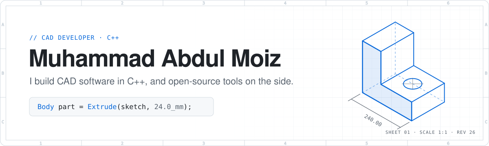
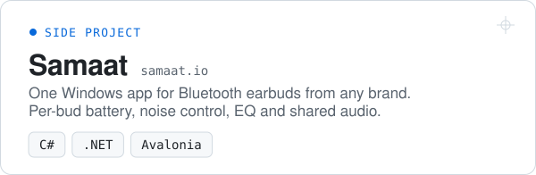
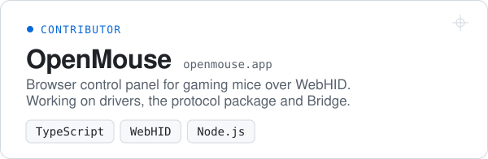
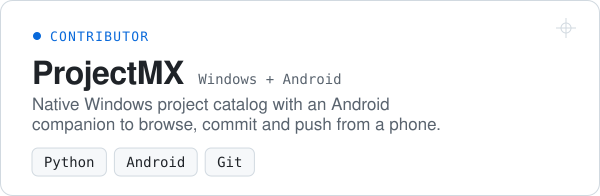
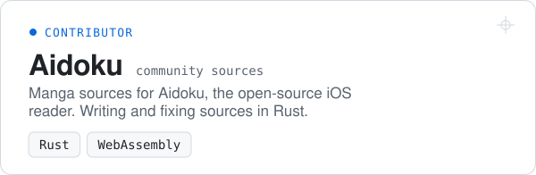
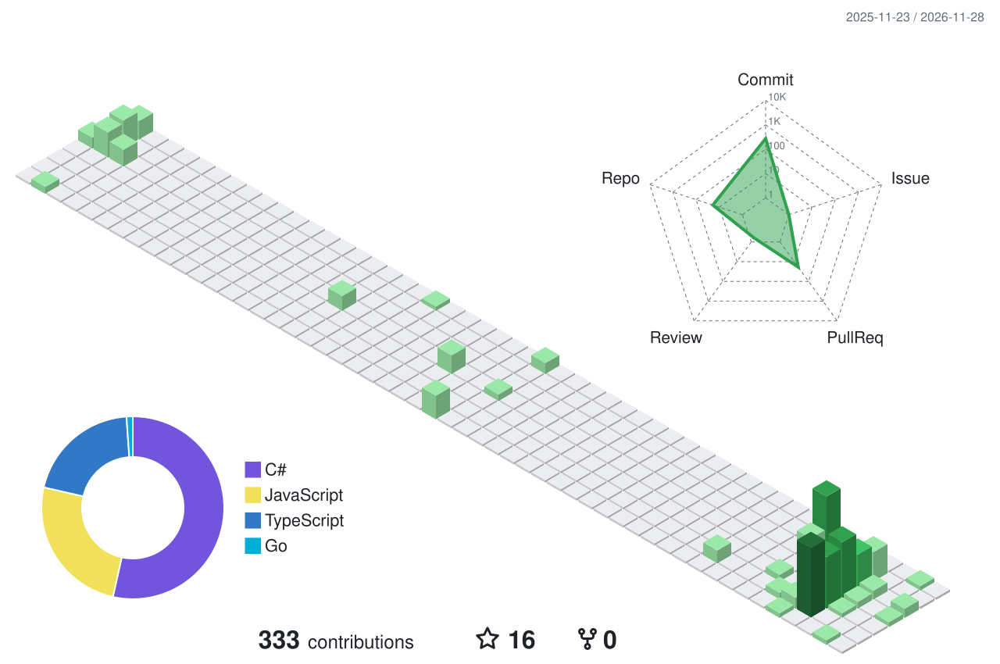

<picture>
  <source media="(prefers-color-scheme: dark)" srcset="assets/header-dark.svg" />
  <source media="(prefers-color-scheme: light)" srcset="assets/header-light.svg" />
  
</picture>

  

I'm a **CAD developer** writing **C++**: geometry, modelling tools and the workflows engineers use to design real parts. After hours I build open-source tools for the hardware I use every day, and contribute to projects I rely on.

 

### What I'm building

  <a href="https://github.com/MuhammadAbdulMoiz/samaat.io"><picture><source media="(prefers-color-scheme: dark)" srcset="assets/card-samaat-dark.svg" /></picture></a>
  <a href="https://github.com/OpenMouse-Project/openmouse"><picture><source media="(prefers-color-scheme: dark)" srcset="assets/card-openmouse-dark.svg" /></picture></a>
  <a href="https://github.com/ammarrmalik185/ProjectMX"><picture><source media="(prefers-color-scheme: dark)" srcset="assets/card-projectmx-dark.svg" /></picture></a>
  <a href="https://github.com/Aidoku-Community/sources"><picture><source media="(prefers-color-scheme: dark)" srcset="assets/card-aidoku-dark.svg" /></picture></a>

 

### Contribution skyline

<picture>
  <source media="(prefers-color-scheme: dark)" srcset="profile-3d-contrib/skyline-dark.svg" />
  <source media="(prefers-color-scheme: light)" srcset="profile-3d-contrib/skyline-light.svg" />
  
</picture>

 

### Toolbox

  

  <a href="mailto:moiza354@gmail.com">moiza354@gmail.com</a> &nbsp;·&nbsp; <a href="https://github.com/MuhammadAbdulMoiz?tab=repositories">All repositories</a>

