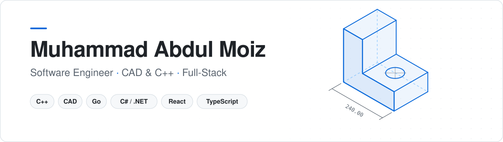

<picture>
  <source media="(prefers-color-scheme: dark)" srcset="assets/header-dark.svg" />
  <source media="(prefers-color-scheme: light)" srcset="assets/header-light.svg" />
  
</picture>

  <a href="mailto:moiza354@gmail.com">Email</a>
  &nbsp;·&nbsp;
  <a href="https://github.com/MuhammadAbdulMoiz?tab=repositories">Repositories</a>
  &nbsp;·&nbsp;
  <a href="https://payprecision2.vercel.app">Live demo</a>

 

I'm a software engineer building **CAD software in C++**: the geometry, tools and workflows engineers use to design real parts. Outside of CAD I build full-stack products, from backend services in Go, .NET and Node.js to React front ends.

I like work that sits close to the metal and close to the user at the same time: fast, correct core code with an interface people actually enjoy using.

 

#### Currently

- Engineering CAD features in **C++**
- Building **[ai-cad](https://github.com/MuhammadAbdulMoiz/ai-cad)**, AI-assisted tooling for CAD workflows
- Exploring microservices with **Go, gRPC and GraphQL**

 

#### Toolbox

  
  &nbsp;&nbsp;
  
  &nbsp;&nbsp;
  

 

#### Selected work

<table>
  <tr>
    <td width="50%" valign="top">
      <b><a href="https://github.com/MuhammadAbdulMoiz/ai-cad">ai-cad</a></b> 
      AI-assisted tooling for CAD workflows.  
      <code>TypeScript</code>
    </td>
    <td width="50%" valign="top">
      <b><a href="https://github.com/MuhammadAbdulMoiz/payprecision">PayPrecision</a></b> &nbsp;<a href="https://payprecision2.vercel.app">live ↗</a> 
      Salary calculator with overtime and leave logic, dark and light themes, and PDF invoices.  
      <code>React</code> <code>Vite</code> <code>Tailwind</code>
    </td>
  </tr>
  <tr>
    <td width="50%" valign="top">
      <b><a href="https://github.com/MuhammadAbdulMoiz/go-micro">go-micro</a></b> 
      Microservices system with GraphQL, gRPC, Postgres and Elasticsearch.  
      <code>Go</code> <code>gRPC</code> <code>Docker</code>
    </td>
    <td width="50%" valign="top">
      <b><a href="https://github.com/MuhammadAbdulMoiz/JWT-Authentication-with-.NET">JWT Auth with .NET</a></b> 
      Complete JWT authentication flows with EF Core and code-first migrations.  
      <code>C#</code> <code>.NET 9</code> <code>SQL Server</code>
    </td>
  </tr>
  <tr>
    <td width="50%" valign="top">
      <b><a href="https://github.com/MuhammadAbdulMoiz/go-secure-api">go-secure-api</a></b> 
      Modular JWT-secured API with middleware and password hashing.  
      <code>Go</code> <code>Gin</code> <code>MongoDB</code>
    </td>
    <td width="50%" valign="top">
      <b><a href="https://github.com/MuhammadAbdulMoiz/cloud-networking-vpc-lab">cloud-networking-vpc-lab</a></b> 
      AWS VPC with public and private subnets, NAT and EC2, plus diagrams.  
      <code>AWS</code> <code>Bash</code>
    </td>
  </tr>
</table>

 

  Open to collaborations and interesting problems. Say hi at <a href="mailto:moiza354@gmail.com">moiza354@gmail.com</a>.

